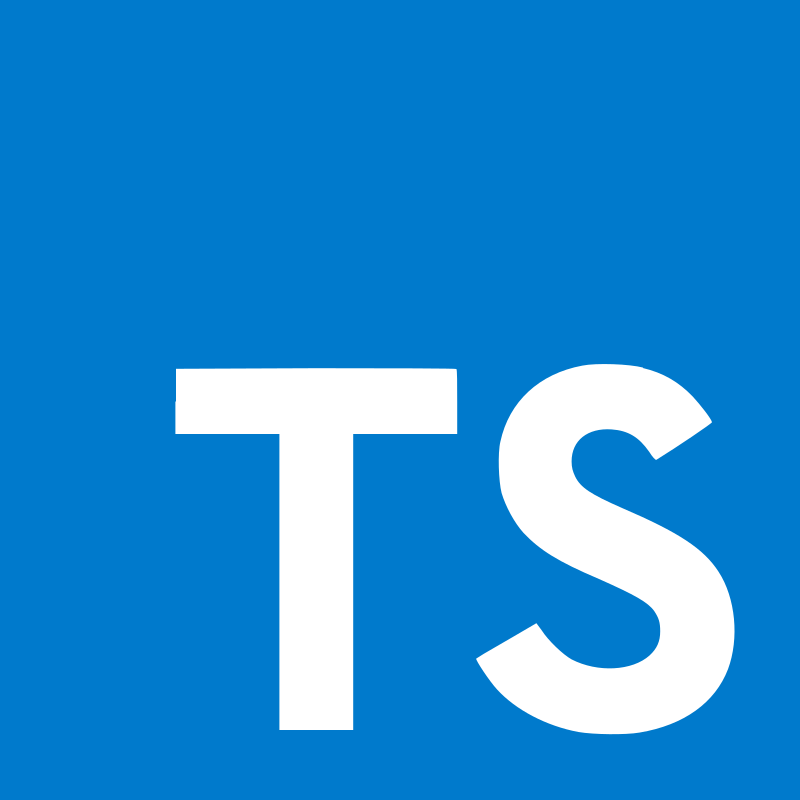
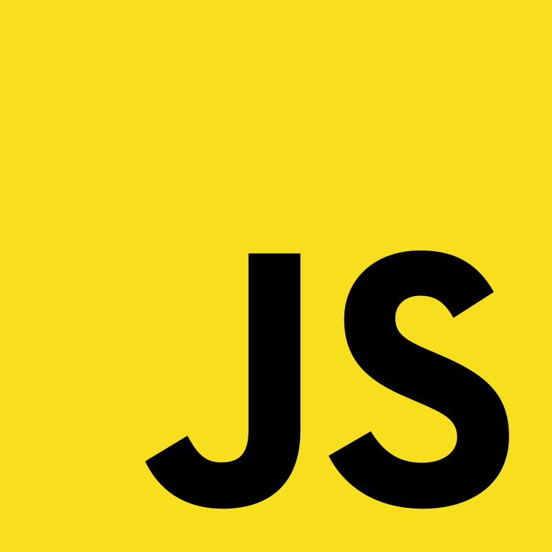
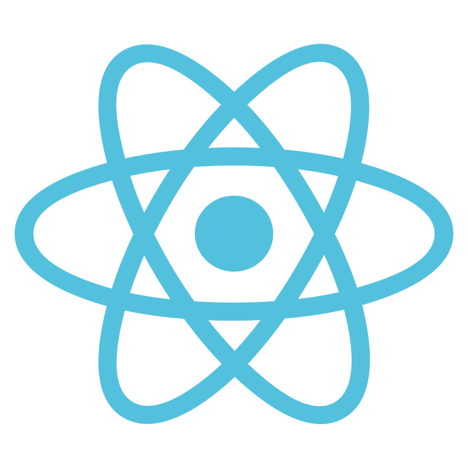
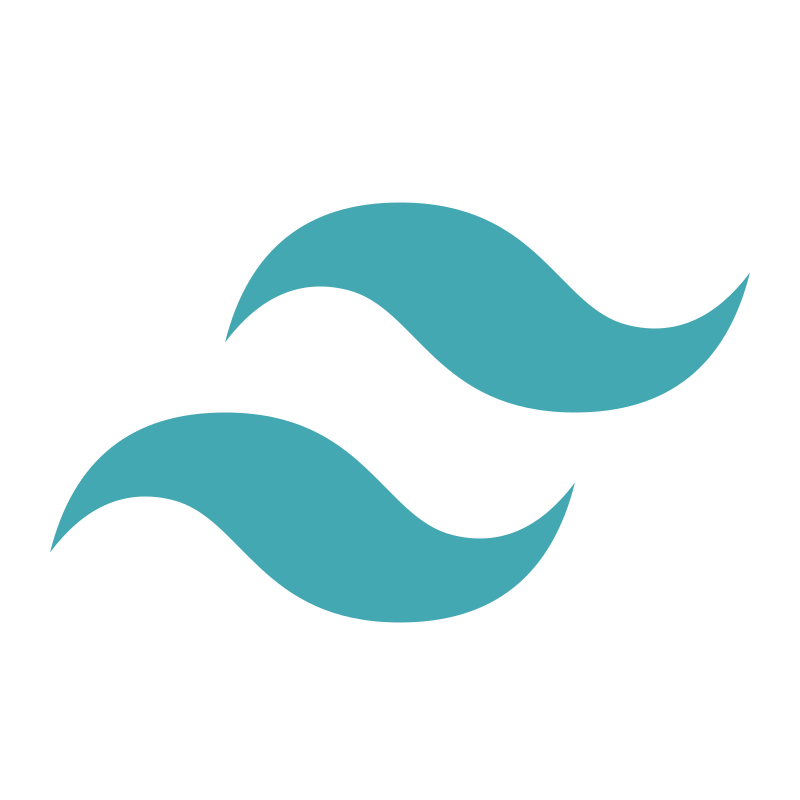
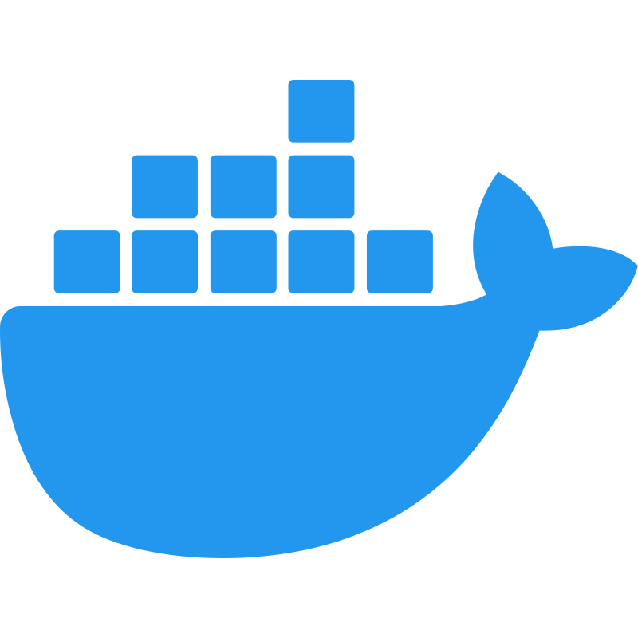
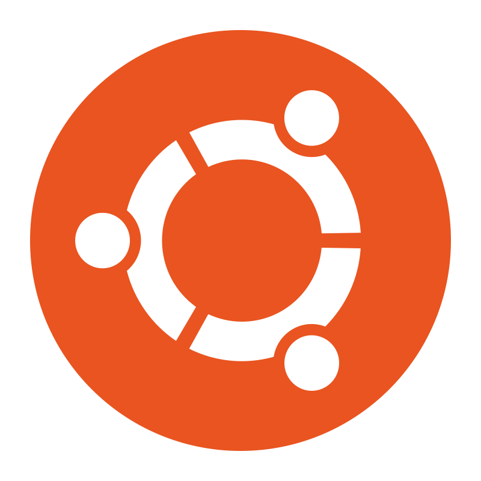
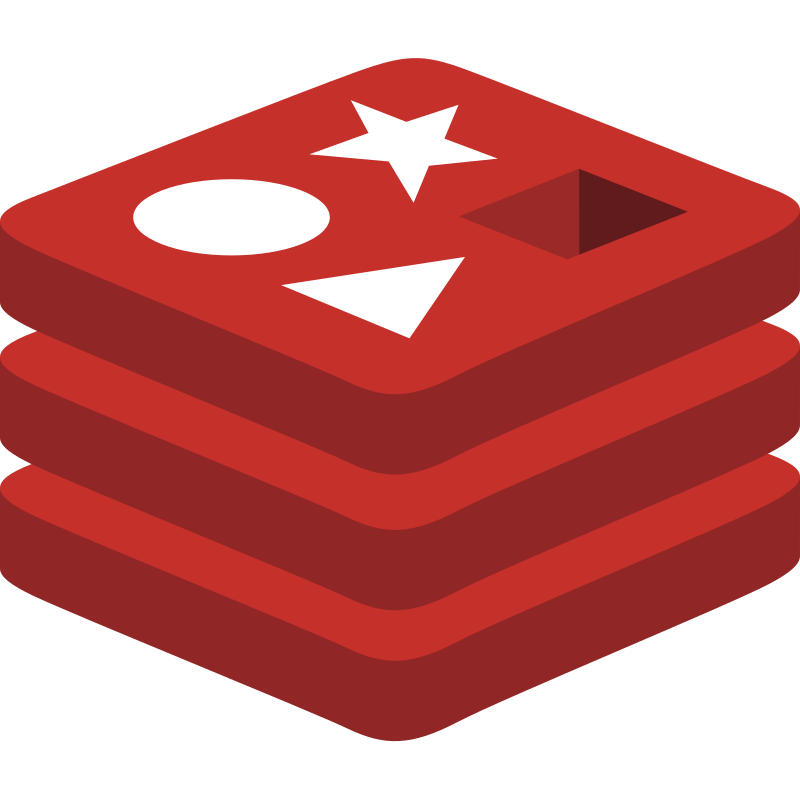
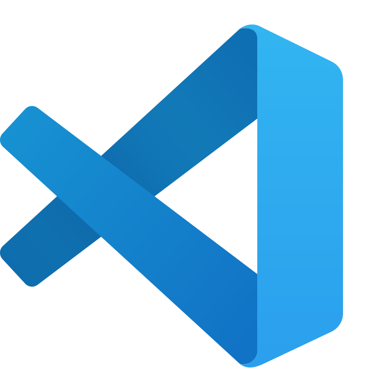
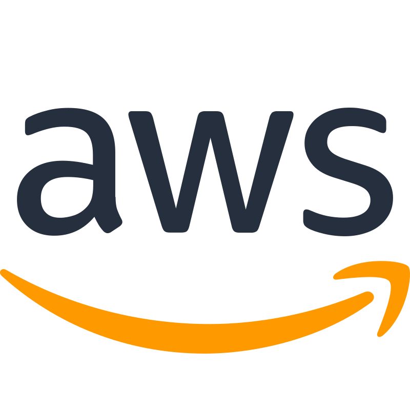

# Hi, I'm Ziad 👋

I design and build scalable, secure, and performant **backend systems** with a focus on **.NET**.

**Technologies I work with:**

  
  
  
  
  
  
  
  
  
  
  
  

---

**Let's connect:**

- Linkedin - [@zyahya](https://linkedin.com/in/zyahya)
- Email - [hello@ziad.dev](mailto:hello@ziad.dev)
- X (twitter) - [@ziadlabs](https://x.com/ziadlabs)
