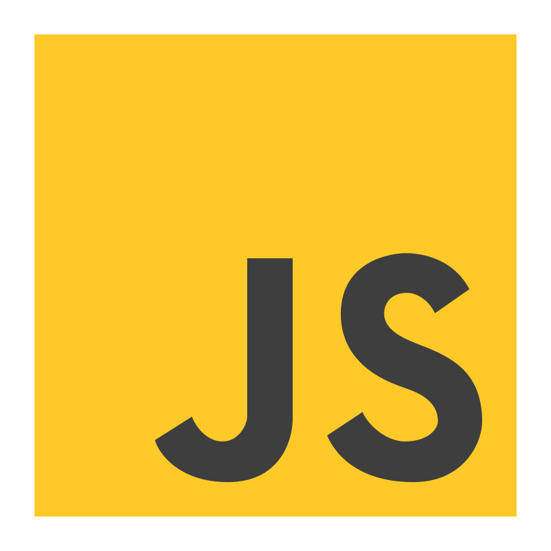
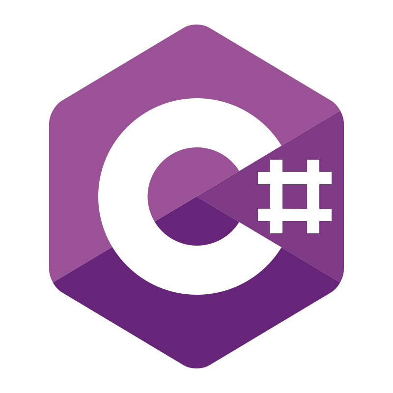
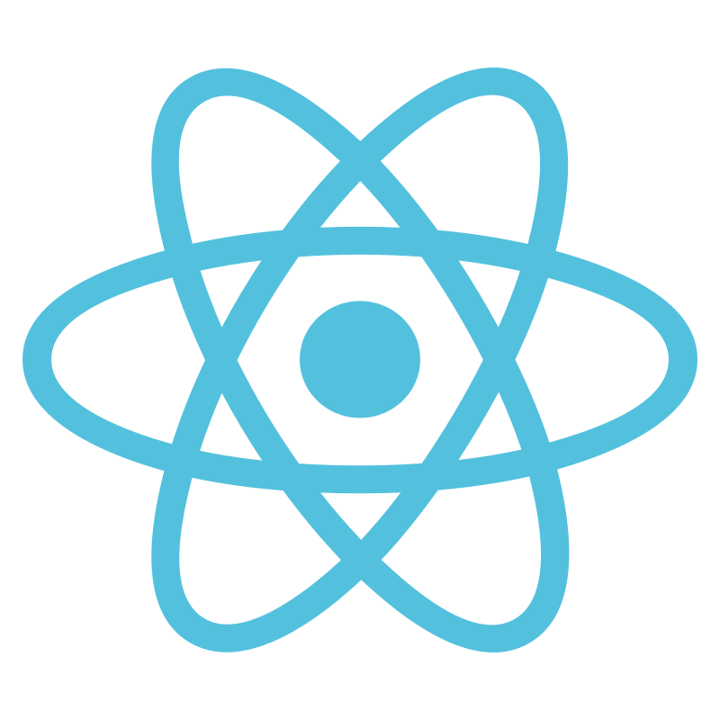
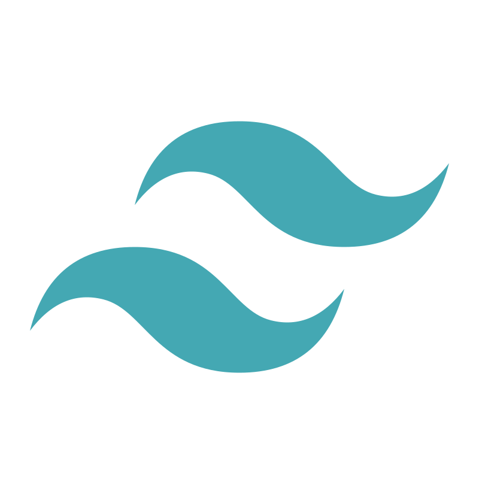
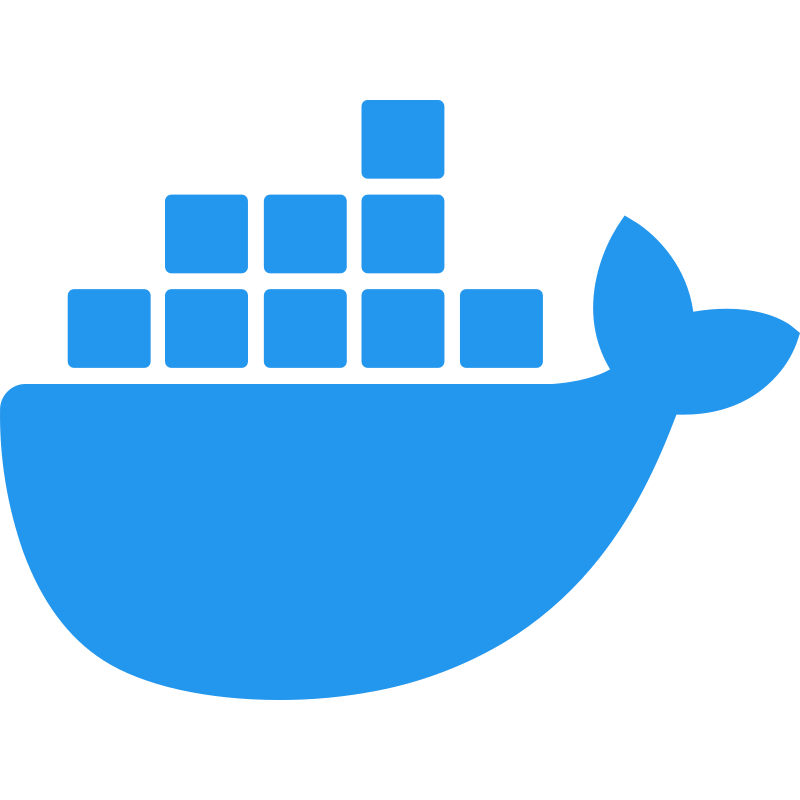
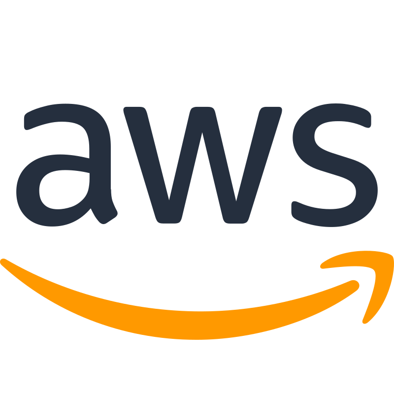
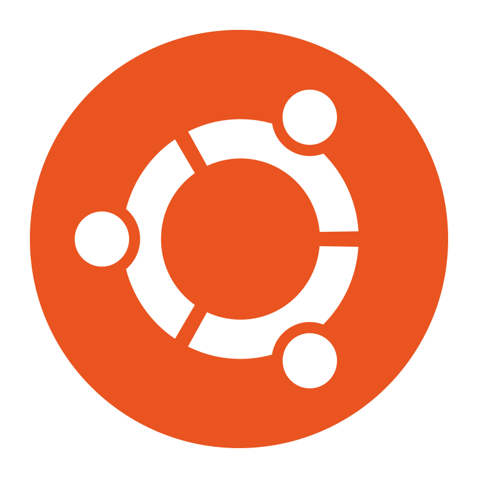
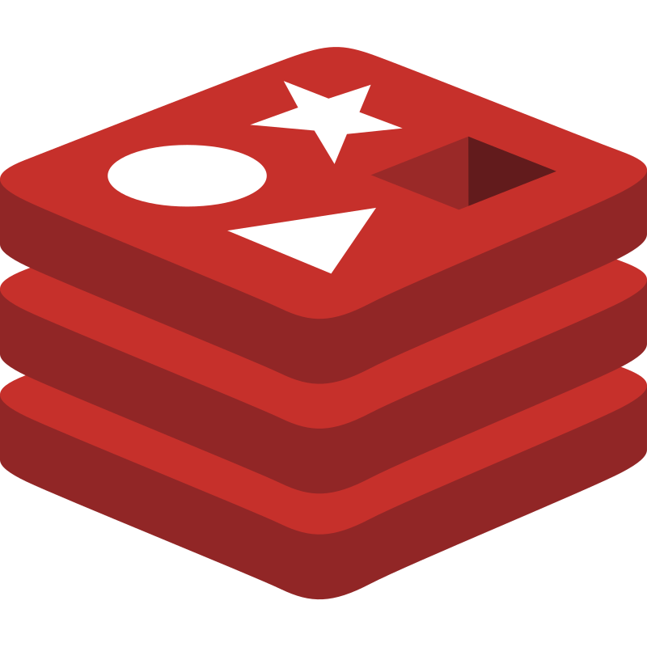
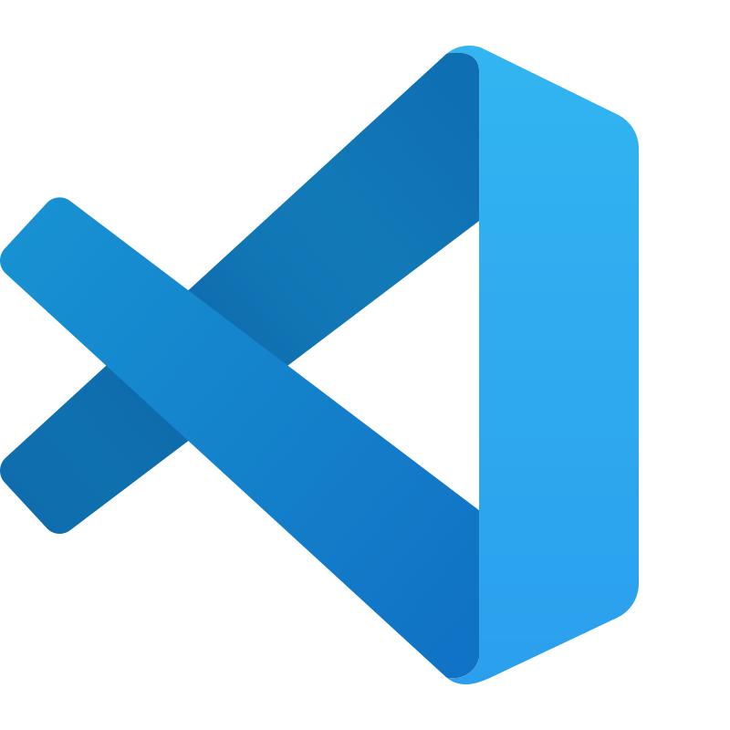

# Hi, I'm Ziad 👋

I build scalable, secure, data intensive backend systems that serve millions across the world 🌠

Here some of my tools:

    
    
    
    
    
    
     
    
    
    
    
    

 

---

 

Feel free to contact me:

- Linkedin - [@zyahya](https://linkedin.com/in/zyahya)
- Email - [hello@ziad.dev](mailto:hello@ziad.dev)
- X (twitter) - [@ziadlabs](https://x.com/ziadlabs)
